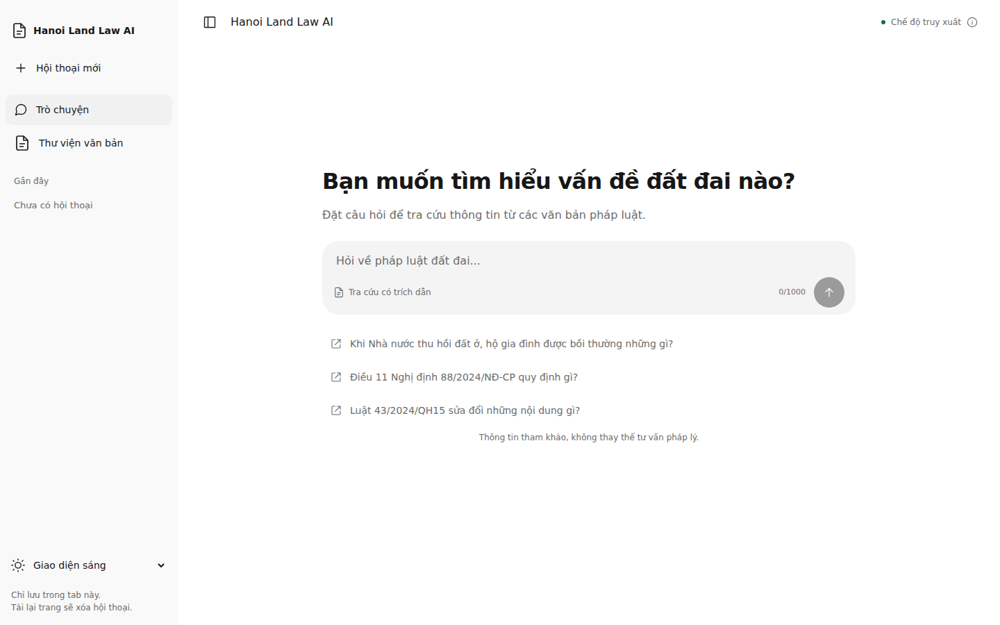
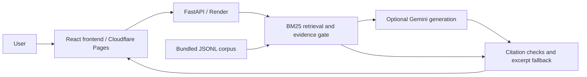
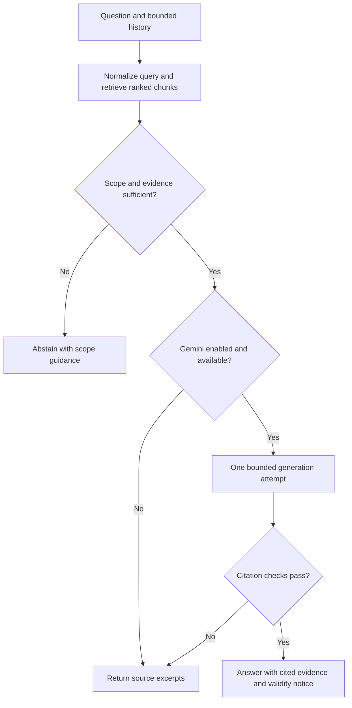

# Hanoi Land Law AI

**AI-Powered Vietnamese Land Law Assistant**

A Vietnamese question-answering application that retrieves legal provisions,
optionally summarizes them with Gemini, and returns traceable source excerpts.
Built as a lightweight, reproducible AI engineering research MVP.

## Overview

Hanoi Land Law AI helps students, researchers and users explore a small collection
of Vietnamese land-related legal documents. Deterministic BM25 retrieval connects
natural-language questions to article-level evidence; bounded generation and
citation checks support source inspection rather than ungrounded answers.

**Research use:** the bundled documents have technically checked extraction, but
their current legal validity is unverified. This is not comprehensive Hanoi legal
coverage or legal advice. Always consult official sources and qualified advisers.

## Demo and interface

- [Web application](https://hanoi-land-law-ai.pages.dev)
- [Backend demo readiness](https://hanoi-land-law-ai-demo.onrender.com/demo/readyz)

These deployments are recorded in the [release evidence](docs/ui-redesign/implementation-summary.md#deployment-readiness).
That release verified retrieval-only operation with Gemini disabled; availability
and current remote settings were not rechecked during this offline cleanup.



## Key features

- **Vietnamese legal Q&A:** accented and accent-free lexical search, explicit
  document/article lookup, and scope/evidence checks before generation.
- **Evidence-first responses:** numbered citations, article headings, source
  excerpts and official-source links; retrieval-only mode requires no API key.
- **Optional Gemini generation:** one bounded generation attempt per turn, shared
  usage accounting, and excerpt fallback when unavailable or rejected.
- **Citation integrity checks:** evidence-ID resolution and selected article,
  date and quotation checks—not independent legal or semantic verification.
- **Anonymous chat:** multiple in-tab conversations, drafts, cancellation and
  rate-limit guidance; conversations clear on reload.
- **Document library:** search, type filters, pagination, article reader,
  citation navigation and browser print/PDF export.
- **Responsive interface:** mobile navigation, keyboard-aware composer and
  light/dark themes.

## System architecture



The public path is `MvpRagPipeline`. It needs **no neural embeddings, Qdrant,
GPU or LangGraph execution**. Authenticated APIs, optional neural pipelines and
corpus preparation tools remain available separately. See [architecture](docs/architecture.md).

## RAG workflow



Greetings use deterministic replies without retrieval or Gemini. History informs
generation only; it does not rewrite the search query. See [pipeline details](docs/rag-pipeline.md).

## Legal corpus

The committed `MVP_DEMO_CORPUS` contains **2 instruments, 90 chunks and 77,243
source-text characters** (not bytes or model tokens).

| Instrument | Included scope | Chunks |
|---|---|---:|
| `43/2024/QH15` | Amendments to several laws, including the Land Law | 7 |
| `88/2024/NĐ-CP` | Compensation, support and resettlement upon land recovery | 83 |

Official government source URLs, raw/parsed hashes, article structure and exact
parsed-text offsets are preserved. Article spans are split with a deterministic
UTF-8 byte budget; decree annex/form templates are excluded. The complete Land Law
`31/2024/QH15` and Hanoi-specific instruments are **not** bundled. All chunks retain
`validity_status=unknown`. See [corpus and reproducibility](docs/corpus.md).

## Technology stack

| Area | Active MVP technologies |
|---|---|
| Frontend | React 19, TypeScript 5.9, React Router, Tailwind CSS 4, react-markdown |
| Build | Vite through pinned `rolldown-vite`, npm lockfile |
| Backend | Python 3.12, FastAPI, Uvicorn, Pydantic Settings |
| Retrieval | Local deterministic Vietnamese BM25 with heading boosts and reference filtering |
| Generation | Google Gen AI SDK / Gemini through the shared budgeted provider |
| Storage | Bundled JSONL; SQLite/SQLAlchemy/Alembic for application schema and SQLite usage ledger |
| Corpus preparation | PDF/DOCX/HTML parsing, legal structure extraction and source-span chunking |
| Validation | pytest with network blocking; ESLint, TypeScript, Node built-in tests |
| Hosting | Cloudflare Pages static frontend and Render Python backend |

Dependency lockfiles also retain tested optional ingestion, batch and neural
retrieval workflows; those are not prerequisites for the public MVP.

## Evaluation highlights

**Provisional offline retrieval measurements**, not legal-answer accuracy:

| Measure | Held-out result |
|---|---:|
| Recall@5 | 92.5% |
| MRR@5 | 0.900 |
| Hit@5 | 95.0% |
| Exact article lookup | 5/5 |

The source-authored dataset contains 44 cases: 12 development and 32 held-out
(20 answerable, 12 negative). Retrieval averages use the 20 answerable cases and
version-specific chunk labels. **None of the 44 labels has independent human
approval.** These scores measure retrieval before the evidence gate, not end-to-end
answer correctness; generated-answer quality remains unmeasured. See
[methodology and complete evidence](docs/evaluation.md), including gate and
adversarial citation results. No live Gemini or judge calls are needed.

## Getting started

### Prerequisites

- Python **3.12**, [uv](https://docs.astral.sh/uv/) and Node.js **22.21+ or 24**.
- No GPU, model downloads, vector database or Gemini key for the default demo.

From the repository root:

```bash
python3 scripts/setup_env.py
uv sync --frozen
npm --prefix frontend ci --ignore-scripts --no-audit --no-fund
```

The setup script creates an ignored root `.env` with a random JWT secret and
leaves any existing `.env` unchanged. Reconcile existing settings manually with
[`.env.example`](.env.example); keep `ENABLE_LIVE_LLM=false` for offline use.

Start each process in a separate terminal:

```bash
uv run --frozen uvicorn backend.main:app --host 127.0.0.1 --port 8000
```

```bash
npm --prefix frontend run dev
```

Open <http://127.0.0.1:5173>. API documentation is at
<http://127.0.0.1:8000/docs>; demo readiness is
<http://127.0.0.1:8000/demo/readyz>. The separate authenticated `/readyz` may
return 503 without affecting the demo. Offline legal questions return retrieved
excerpts, not generated summaries.

### Environment configuration

Use one **root `.env`**; never create backend/frontend environment files or expose
credentials through `VITE_*`. OS environment values take precedence.

| Setting | Template value / purpose |
|---|---|
| `JWT_SECRET_KEY` | Generated by setup; template placeholder is intentionally rejected |
| `ENABLE_LIVE_LLM`, `GEMINI_API_KEY` | `false`, empty; enabling live generation requires explicit approval and a valid key |
| `MODEL` | Template/Render select `gemini-3.5-flash-lite`; account availability must be checked before live use |
| `MAX_LLM_CALLS_PER_TURN`, `MAX_LLM_CALLS_PER_DAY` | 1 / 8 application attempts; not provider quotas or billing guarantees |
| `MAX_LLM_OUTPUT_TOKENS`, `LLM_REQUEST_TIMEOUT_SECONDS`, `LLM_MAX_RETRIES` | 1024 / 20 / 0 |
| `VITE_API_BASE_URL` | Public API origin, `http://127.0.0.1:8000` locally; baked into frontend build |
| `CORS_ORIGINS` | JSON array of exact frontend origins; no wildcard |
| `MVP_DEMO_CORPUS_PATH`, `MVP_ENABLED` | Bundled JSONL path / `true` |
| `MVP_TOP_K`, `MVP_MIN_SCORE`, `MVP_MIN_COVERAGE` | 6 / 5.0 / 0.5 |
| `MVP_RATE_LIMIT_PER_MINUTE`, `MVP_RATE_LIMIT_PER_DAY` | 6 / 60 per observed client IP, process-local |
| `DATABASE_URL`, `LLM_USAGE_DB` | Root-relative local SQLite paths; back up existing databases and preserve usage ledgers |

The Python-only fallback model differs from the template. Use the template
explicitly; [environment setup](docs/environment-setup.md) distinguishes template
values from code defaults and covers context limits and optional workflows.

### Development checks

```bash
uv lock --check
uv pip check
uv run --frozen pytest -q
npm --prefix frontend run lint
npm --prefix frontend run typecheck
npm --prefix frontend run build
npm --prefix frontend test
git diff --check
```

pytest blocks network sockets and uses temporary databases and mocked providers.
Do not bypass these safeguards or run live judges to reproduce offline checks.

## Deployment

- **Render:** [`render.yaml`](render.yaml) installs with `uv sync --frozen --no-dev`,
  starts `backend.main:app` on `$PORT`, and checks `/demo/readyz`.
- **Cloudflare Pages:** build `npm --prefix frontend run build`; publish
  `frontend/dist`. Set the HTTPS `VITE_API_BASE_URL` at build time and allow the
  exact Pages origin in backend CORS. `_redirects` supports client-side routes.
- **Local containers:** Dockerfiles and Compose are provided; Qdrant is an
  optional profile and is unnecessary for the demo.

The Blueprint enables production generation under the approved application budgets;
local setup keeps it off. Hosting state may differ from committed configuration.
See the [deployment guide](docs/deployment.md) for commands,
persistence/proxy prerequisites and verification without live generation.

## Project structure

```text
backend/          FastAPI APIs, services, migrations and bundled demo corpus
frontend/         React application and Node regression tests
tests/            Offline backend, ingestion and evaluation regression tests
evaluation/       MVP datasets, metric code, review worksheets and raw reports
corpus/           Source registries, approvals and discovery provenance
preprocess/       Parsing, chunking and guarded offline ingestion
law_crawler/      Controlled source acquisition and quality tooling
batch/            Optional embedding/batch contracts and transfer tooling
notebooks/        Optional Colab handoff notebook
benchmarks/       Separate retained retrieval/DeepEval tooling
scripts/          Setup, corpus builder and local audit utilities
docs/             Current guides and preserved technical evidence
```

## Documentation

- [Architecture and API boundaries](docs/architecture.md)
- [RAG pipeline and citation behavior](docs/rag-pipeline.md)
- [Legal corpus and provenance](docs/corpus.md)
- [Environment setup](docs/environment-setup.md) · [Deployment](docs/deployment.md)
- [Evaluation methodology and results](docs/evaluation.md)
- [Documentation index](docs/README.md) · [Repository maintenance record](docs/repository-maintenance.md)

## License and attribution

The repository retains the **modified MIT License (No Attribution Required)** in
[LICENSE](LICENSE), naming Tran Tuan Kiet and Nguyen My Thong (2025). Hanoi Land
Law AI adapts inherited ViLeXa functionality; it does not claim exclusive authorship
of that code. The software license does not grant rights to third-party models,
datasets, government-portal assets or legal source artifacts; their respective
terms and provenance remain applicable.
