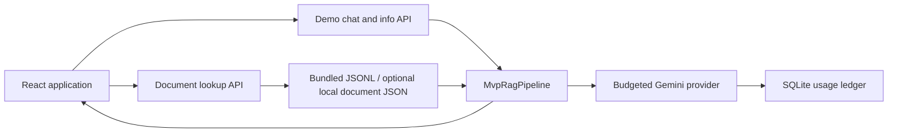

# Architecture

## Public MVP

The default browser routes `/` and `/lookup` expose anonymous chat and a document
library. The browser uses public JSON APIs with `credentials: 'omit'`, not an
authentication cookie or bearer token. API base configuration is compiled from
root `VITE_API_BASE_URL`; FastAPI permits exact frontend origins through CORS.

`backend.main.create_app` owns injected services, settings and database lifespan.
Startup applies Alembic migrations and loads the small lexical index. It does not
download weights, connect to Qdrant or initialize the authenticated RAG pipeline.
The database remains a startup prerequisite even though demo turns do not persist
chat rows. An import of `backend.main` creates the app, but lifespan owns database
and corpus initialization.

## API boundaries

All business routes below use prefix `/api/v1` by default. Health routes do not.
The generated `/docs` page provides complete request/response contracts.

| Surface | Routes | State and access |
|---|---|---|
| Demo | `GET /demo/info`, `POST /demo/chat` | Anonymous; bounded client-supplied history; no saved sessions |
| Documents | `GET /documents`, `/documents/search`, `/documents/types`, `/documents/{id}`, `/documents/{id}/articles`; `POST /documents/search-by-content` | Public; JSON lookup service, not Qdrant |
| Auth | `POST /auth/register`, `/auth/login`; `GET /auth/me` | Retained account API; JWT protected identity endpoint |
| Sessions | `POST/GET /sessions`; `GET/PATCH/DELETE /sessions/{id}` | Retained authenticated, owner-scoped persistence |
| Authenticated chat | `POST /chat` | Separate lazy neural/agentic path; not used by public UI |

| Health route | Meaning |
|---|---|
| `/healthz` | Process liveness; no provider probe |
| `/demo/readyz` | Database ready and demo index initialized; correct MVP hosting check |
| `/readyz` | Database and authenticated RAG ready; 503 may be expected during demo use |

## Retrieval and generation

`MvpCorpusIndex` constructs an in-memory BM25 index from bundled JSONL. It boosts
document numbers/headings, filters explicit references and diversifies articles.
`MvpRagPipeline.respond` performs greeting handling, retrieval, deterministic
scope/sufficiency checks, optional generation and citation checks. No LangGraph,
embedding model, vector store, learned reranker or query-rewrite loop runs here.
See [pipeline behavior](rag-pipeline.md) and [corpus format](corpus.md).

All live generation uses `backend/services/llm.py`. The lazy Gemini provider
checks consent, reserves usage in SQLite, enforces attempt/output/time limits
and disables SDK retries/tracing. The MVP overrides the per-turn cap to one.
The template disables application retries as well. Selected citation checks
resolve source IDs; they cannot prove semantic entailment or current legal validity.

## State, privacy and controls

- Demo conversations/drafts live in React memory; only theme preference persists
  locally. Reload clears chat. Recent history travels with each request.
- Demo rate limits are per observed client IP, process-local and restart-sensitive.
  `429` exposes `Retry-After`; frontend cancellation does not guarantee cancellation
  of already-running backend/provider work.
- Live generation transmits question, bounded history and source context to Google.
  Users should not submit confidential case data. Hosting metadata retention is
  distinct from application chat persistence.
- Retained authenticated chat uses SQLAlchemy, ownership checks and atomic
  user/assistant message pairs. Do not remove migrations or weaken access controls
  because the public UI does not expose login.

## Hosting topology

Cloudflare Pages serves static frontend assets; Render runs Uvicorn and the
bundled corpus. SQLite files live with the backend. Free-host ephemeral storage
does not guarantee durable usage accounting or account/session storage. Proxy
trust must be limited to controlled ingress. See [deployment](deployment.md).

## Retained optional workflows

`preprocess/`, `law_crawler/`, `batch/` and `notebooks/` support controlled
acquisition, review and embedding transfer. `backend/services/pipelines/` also
retains neural/LangGraph implementations, and `benchmarks/` retains separate
benchmark tooling. Their dependencies, tests and provenance are intentionally
preserved; none is evidence that the deployed MVP executes them. Live DeepEval
judges remain blocked. Setup does not authorize crawling or model downloads.
