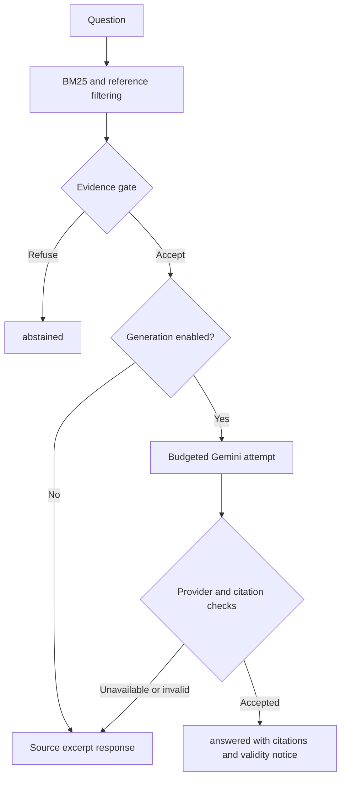

# RAG pipeline

The public pipeline is implemented in
[`mvp_rag_pipeline.py`](../backend/services/pipelines/mvp_rag_pipeline.py) and
[`mvp_corpus.py`](../backend/services/mvp_corpus.py). It is deterministic until
the optional generation step.

## Query processing and retrieval

1. The API validates a message (default maximum 1,000 characters), applies IP rate
   limits, and bounds supplied history to six messages / 4,000 characters.
2. Greeting, thanks and capability patterns return deterministic text with no LLM.
3. Unicode normalization, lowercasing and accent-folded Vietnamese forms support
   lexical matching. This is regex tokenization, not neural word segmentation.
4. BM25 uses `k1=1.5`, `b=0.75`. Document-number tokens are repeated twice and
   heading tokens four times; body tokens retain their original frequency.
   Additional heading-term and heading-bigram bonuses influence rank.
5. Explicit document/article references filter candidates. Generic document
   overviews prefer Article 1 when available. Absent explicit articles do not
   silently fall back to unrelated articles.
6. Within the top 24 candidates, diversification prefers at most two chunks per
   article, then appends overflow. It is a preference, **not an absolute cap**.
   The default final retrieval count is six.

History is not used to expand or rewrite the retrieval query. Ranking is lexical;
there is no embedding similarity, learned reranker or LLM relevance judge.

## Evidence sufficiency

The gate checks domain/scope vocabularies, explicit references and evidence:

| Check | Default |
|---|---:|
| Top score minimum (`MVP_MIN_SCORE`) | 5.0 |
| Top-hit content-term coverage (`MVP_MIN_COVERAGE`) | 0.5 |
| Top-hit heading coverage | 0.30 |
| Minimum score-qualified hits | 1 |

Generic document overviews have a special acceptance path. Explicit article
matches bypass the heading-coverage check, not every scope/coverage condition.
Refusals identify out-of-domain, outside-corpus, absent-reference, weak-match or
insufficient-evidence conditions and make no provider call. These are heuristic
gates, not proofs that selected text answers the question.

## Generation and validation

Evidence is numbered `[E1]` onward. Prompt excerpts are limited to 1,400 characters
per hit; generation history is further bounded to 2,000 characters (up to eight
messages before that bound). The Vietnamese system prompt requests short,
source-only answers and a citation for each legal assertion.

When explicitly enabled, the shared provider makes at most one budgeted attempt
per MVP turn. The template uses a 20-second per-attempt timeout, 1,024 output
tokens, zero retries and eight attempts/day. Failures consume reservations too.

The validator:

- Resolves recognized evidence markers and removes unknown IDs, recording them.
- Requires at least one valid citation for a generated answer.
- Checks recognized quotations of at least 12 characters, article numbers and
  supported date patterns against cited source text after normalization.
- Substitutes selected current-effect phrases with neutral wording.

These checks are not per-claim semantic validation. Mixed valid/invalid markers
can leave an accepted answer; a rejected ID alone does not necessarily reject the
whole answer. Short quotations, clause locators, document/version claims and
semantic contradictions are not comprehensively verified. Checks inspect full
retrieved source chunks, which can exceed the truncated prompt excerpts. Complete
adversarial results remain in the [evaluation evidence](evaluation.md).

## Response behavior

| Status | Behavior |
|---|---|
| `greeting` | Deterministic conversational response |
| `abstained` | Scope/evidence refusal; no generation |
| `llm_disabled` | Retrieved excerpts without synthesis |
| `llm_unavailable` | Excerpts after provider/budget unavailability; a failed upstream attempt may have occurred |
| `citation_rejected` | Generated text discarded; excerpts returned |
| `answered` | Accepted generated text, cited source cards and research validity notice |

The API also returns source metadata, warnings, rejected citations, a request ID,
corpus scope and rate-limit information. `llm_used` describes pipeline outcome,
not transport-level billing accounting; the usage ledger is authoritative for
reserved attempts. The UI renders Markdown, source cards, reader links and fallback
guidance. All legal evidence remains `validity_status=unknown`.
